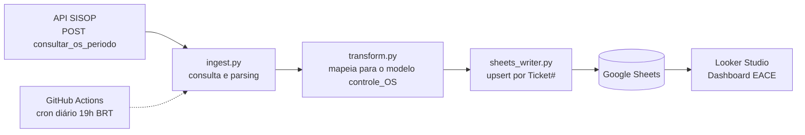

# service-operations-analytics

# Dashboard EACE — Pipeline de Ordens de Serviço (SISOP → Google Sheets → Looker Studio)

Pipeline de dados automatizado que consome a API do sistema de OS (SISOP) usado no projeto de redes em escolas do Maranhão, padroniza os registros no formato do controle operacional (`controle_OS.xlsx`) e alimenta o **Dashboard EACE** no Looker Studio, atualizado todos os dias sem intervenção manual.

> **Status:** em produção · atualização diária via GitHub Actions


## O problema

O acompanhamento das OS de suporte de rede das escolas dependia de uma planilha preenchida manualmente. Isso gerava dados desatualizados, retrabalho e pouca visibilidade sobre quais escolas e tipos de falha concentravam os chamados.

## A solução

Um pipeline em Python que busca as OS direto na API, traduz os campos para o modelo que a operação já usava, grava em uma planilha do Google (preservando o histórico) e serve de fonte para o dashboard.



## Stack

| Camada | Tecnologia |
|---|---|
| Ingestão e tratamento | Python (`requests`, `python-dotenv`) |
| Armazenamento | Google Sheets (`gspread`, OAuth 2.0) |
| Visualização | Looker Studio |
| Automação | GitHub Actions (cron) |
| Segredos | GitHub Secrets / `.env` local |

## Estrutura do projeto

```
.
├── ingest.py            # consulta a API, trata a resposta e orquestra o fluxo
├── transform.py         # traduz os campos da API para o modelo controle_OS
├── sheets_writer.py     # autenticação OAuth e upsert na planilha
├── requirements.txt
├── .env.example         # variáveis de ambiente necessárias (sem valores reais)
└── .github/workflows/
    └── ingest.yml       # execução diária automática
```

## Mapeamento dos campos

| Campo da API | Coluna no modelo |
|---|---|
| Protocolo | Ticket# |
| Escola | Escola |
| INEP | INEP |
| Status | Status |
| OS Falha | Fechamento |
| Data de Criacao | Aberto no dia (e Mês, calculado) |
| Finalizado em | Data da Resolução |
| Ultima Nota | Comentários adicionais |
| *calculado* | Número de dias em aberto |
| *valor fixo do projeto* | Regional (Nordeste I), UF (MA) |

Campos que a API não fornece e ficam em branco: Cidade, Prioridade, Causa1/2/3, Atribuído a, Data paralisado e Data reinicio.

## Decisões técnicas

- **OAuth de usuário em vez de conta de serviço.** A política da organização no Google Cloud bloqueia a criação de chaves de conta de serviço (`iam.disableServiceAccountKeyCreation`). O fluxo OAuth "Desktop app" contorna isso sem enfraquecer a segurança, e o token renovável é levado ao GitHub Actions como Secret.
- **Upsert pelo Ticket#.** Cada execução diária busca apenas as últimas 24h, mas a planilha mantém o histórico: OS novas são acrescentadas e OS existentes são atualizadas (ex.: "Em análise" → "Concluído").
- **Resposta fora do padrão JSON.** A API devolve o corpo no formato `OS[...]`, sem chaves externas. O `ingest.py` detecta isso e extrai o array antes de interpretar.
- **Janela de consulta.** O endpoint só aceita chamadas entre 19h e 9h (Brasília). O agendamento roda às 19h (`0 22 * * *` em UTC).
- **Datas como headers.** A API recebe `data_inicio` e `data_fim` no formato `MM/DD/AAAA` via headers, não por query string ou body.
- **Nenhum segredo no repositório.** Chave da API, credenciais OAuth e token ficam fora do Git (`.gitignore`) e entram no pipeline via Secrets.

## Como rodar localmente

```bash
git clone maycon-castro-git/service-operations-analytics.git
cd <pasta-do-projeto>
pip install -r requirements.txt
cp .env.example .env   # preencha com suas credenciais
python ingest.py --inicio 09/01/2026 --fim 09/30/2026
```

Na primeira execução, o navegador abre para autorizar o acesso à planilha com sua conta Google; o `token.json` gerado é reaproveitado nas próximas.

**Pré-requisitos**

1. Projeto no Google Cloud com a Google Sheets API ativada e um cliente OAuth do tipo "App para computador".
2. Sua conta cadastrada como usuário de teste na tela de consentimento OAuth (enquanto o app estiver em modo de teste).
3. Planilha criada na conta autorizada, com o ID informado no `.env`.

## Automação (GitHub Actions)

O workflow `ingest.yml` roda todo dia às 19h (Brasília), também pode ser disparado manualmente pela aba *Actions*, e usa os seguintes Secrets:

| Secret | Conteúdo |
|---|---|
| `SISOP_API_URL` | URL do endpoint de consulta |
| `SISOP_API_KEY` | Chave de acesso à API |
| `GOOGLE_SHEET_ID` | ID da planilha de destino |
| `GOOGLE_SHEET_TAB` | Nome da aba (ex.: `OS_dados`) |
| `GOOGLE_OAUTH_CLIENT_JSON_B64` | `client_secret.json` em Base64 |
| `GOOGLE_TOKEN_JSON_B64` | `token.json` em Base64 |

Se o token do Google expirar ou for revogado, basta rodar o script localmente para gerar um novo e atualizar o Secret.

## Dashboard EACE

<!-- TODO: descrever as páginas/visões do dashboard e linkar a versão pública, se houver -->

Principais indicadores acompanhados: volume de OS por status, tempo de resolução, escolas com mais chamados e distribuição por tipo de falha.

## Roadmap

- [ ] Enriquecer os registros com outros endpoints da API (ex.: detalhes de falha) para preencher Causa e Prioridade
- [ ] Alertas quando uma OS ultrapassar o prazo de atendimento
- [ ] Testes automatizados para `transform.py`
- [ ] Publicar versão pública do dashboard com dados anonimizados

## Autor

**Maycon Castro** — Analista de Dados & Business Intelligence

[GitHub](https://github.com/maycon-castro-git) · [LinkedIn](www.linkedin.com/in/maycon-castro) · [Portfólio](https://maycon-castro-git.github.io/portfolio-maycon-castro/)
